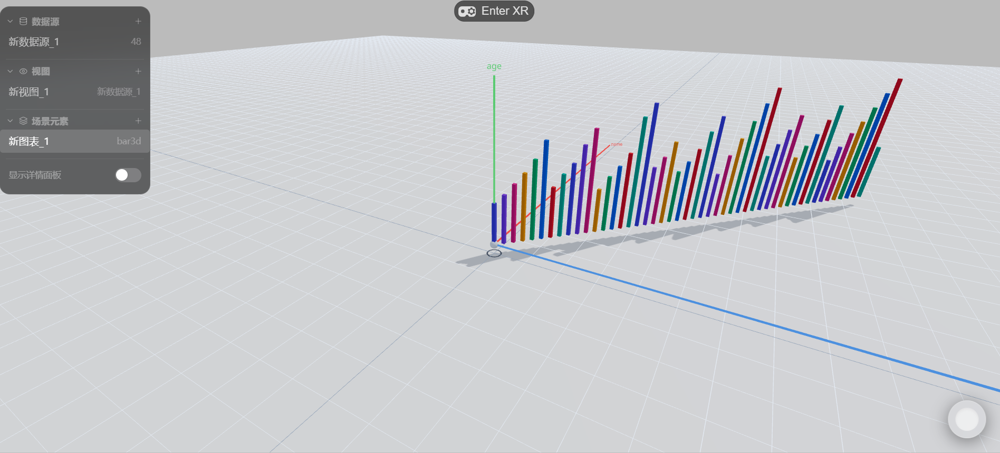
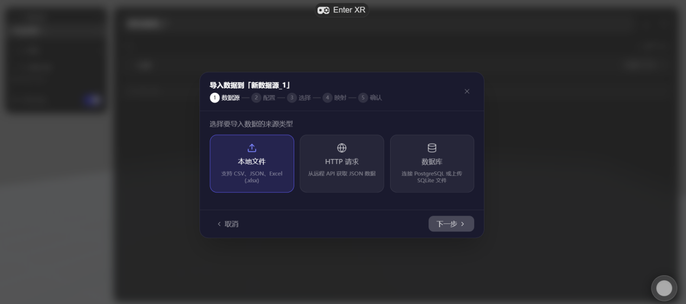
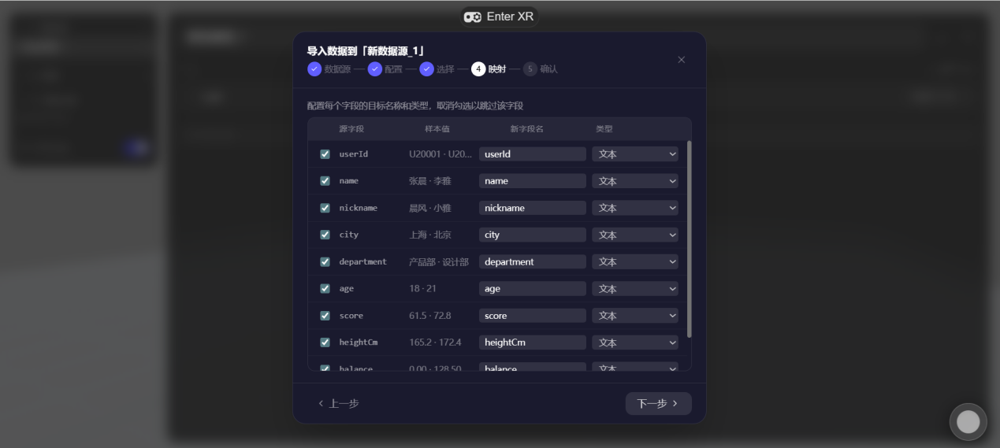
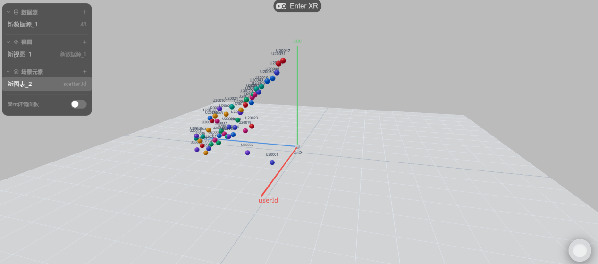
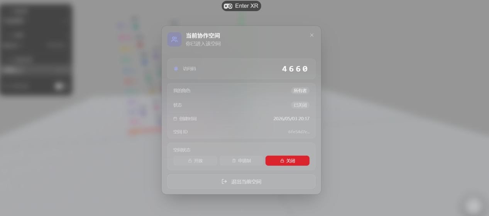
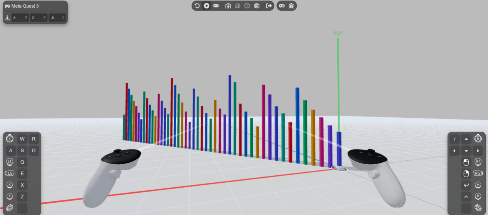

# CoXR

### Immersive Collaborative Data Visualization Platform

A full-stack web application for exploring data in 3D, sharing collaborative workspaces, and interacting through desktop and WebXR interfaces.

**Completed undergraduate capstone · Independently developed · Runs locally**

[Source repository](https://github.com/Sujing9/CoXR) · [Author: Sujing9](https://github.com/Sujing9)



*The implemented desktop interface: a shared workspace with data sources, views, and a 3D chart.*

## Overview

CoXR brings data import, spatial visualization, shared state, and voice communication into one browser application. Users can create or join a workspace, import a dataset, map fields to chart dimensions, and explore the resulting visualization through desktop controls or an immersive interface.

I independently developed CoXR as my undergraduate capstone in Computer Science and Technology, covering system design, frontend and backend implementation, and integration. The project is completed and runs in a local environment. No hosted demo is currently available.

## Implemented Features

- **3D visualization:** bar charts, scatter plots, and line charts rendered with Three.js and React Three Fiber, with configurable data mappings and scene transforms.
- **Desktop and XR interfaces:** a desktop workspace and WebXR spatial panels for navigating charts and workspace functions.
- **Real-time collaboration:** shared workspace documents synchronized with Yjs and Hocuspocus over WebSocket.
- **Workspace management:** space creation, access codes, membership management, and open, approval-based, or closed admission policies.
- **Data import:** CSV, JSON, and Excel files; remote HTTP data; PostgreSQL and uploaded SQLite data sources, followed by field mapping.
- **Authentication:** password login, JWT sessions, and WebAuthn passkeys.
- **Snapshots:** save and restore workspace document states, with owner-controlled restoration.
- **Voice communication:** workspace voice rooms using WebRTC and a mediasoup SFU.
- **Optional AI chart recommendations:** an OpenAI-compatible API integration that requires separate provider configuration.

## Screenshots

These are original application screenshots extracted from the undergraduate design report, **毕业设计说明书 a.docx**. The Chinese interface is preserved. XR images show a desktop simulator with controller overlays; they do not establish physical-headset validation. Screenshots document the interface and are not performance benchmarks.

### Data import and field mapping



*Select a source type, then map source fields into the workspace data model.*



### Desktop data exploration



*The scatter plot presents records as spatially positioned data points.*

### Workspace access management



*Owners control how other users enter a workspace.*

### XR visualization



*The XR interface displays the chart in a spatial environment. This capture includes the simulator's virtual controllers and controls.*

[Image provenance and figure references](docs/screenshots/README.md)

## Technology Stack

| Layer | Technologies |
| --- | --- |
| Frontend | React 19, TypeScript, Vite |
| 3D rendering | Three.js, React Three Fiber, Drei |
| XR and spatial UI | WebXR, React Three XR, React Three UIKit |
| Desktop UI and state | Tailwind CSS, Radix UI, Zustand |
| Backend | Node.js, Fastify 5, TypeScript |
| Collaborative documents | Yjs, Hocuspocus, WebSocket |
| Voice | WebRTC, mediasoup, mediasoup-client |
| Persistence and cache | PostgreSQL, Drizzle ORM, Redis |
| Authentication | JWT, Argon2, SimpleWebAuthn |
| Project tooling | pnpm workspace, Docker Compose for supporting services |

The stack above reflects the implementation. Early report sections mention FastAPI, but the actual backend uses Fastify and TypeScript. The implemented chart types are bar, scatter, and line; network graphs mentioned in the report's introductory material are not listed as implemented features here.

## Architecture and Engineering Decisions

```text
packages/
  web/      React UI, desktop/XR interaction, charts, collaboration client
  server/   Fastify API, authentication, collaboration, voice, persistence
  shared/   Shared types, schemas, permissions, and Yjs document utilities
```

The frontend renders charts from the shared workspace document. Hocuspocus synchronizes Yjs updates between clients, while Fastify provides application APIs and real-time endpoints. PostgreSQL stores structured application data and saved snapshots; Redis stores recent document state and supports the collaboration service. Voice traffic uses the separate mediasoup media pipeline.

- **Authorize real-time connections:** collaboration authentication checks the JWT and workspace membership before admitting a client to the shared document.
- **Handle multiple browser tabs:** the disconnect handler checks for the user's remaining connections before updating membership status.
- **Recover shared state:** document updates are encoded into Redis with an expiry, and the last-client disconnect handler includes an immediate save path. User-created snapshots provide a separate recovery mechanism.
- **Constrain external imports:** import handling includes network-address checks, bounded result sizes, and read-only SQLite access. These are implementation measures, not a claim of an independent security audit.
- **Reuse domain models:** the shared package keeps types, schemas, permissions, and document utilities available to both client and server.

## Local Development

**Setup status:** the author has run the completed application locally. The following guidance is based on inspected project files; it has not been verified on a clean installation during preparation of this README.

### Prerequisites

- Node.js **>= 22.22.0** and **pnpm 9.15.4**, as declared in the root package configuration.
- PostgreSQL and Redis. The repository's Compose file specifies PostgreSQL 17 and Redis 7.
- A browser supporting the required WebRTC and WebAuthn features; a compatible WebXR environment for immersive mode.

### Development workflow

```bash
git clone https://github.com/Sujing9/CoXR.git
cd CoXR
pnpm install
```

Before starting the application, provision PostgreSQL and Redis, configure the server environment, and initialize the database using the project's Drizzle configuration and an appropriate existing migration workflow. The server package exposes `db:generate`, `db:push`, and `db:migrate`; choose the workflow appropriate to your database rather than running all three in sequence.

Check `packages/server/src/env.ts` for configuration names. In particular, configure `DATABASE_URL`, `REDIS_URL`, and a `JWT_SECRET` of at least 32 characters. WebAuthn origin settings must match the frontend origin. Voice networking uses the `MEDIASOUP_*` settings. AI recommendations additionally require `OPENAI_API_URL`, `OPENAI_API_KEY`, and `OPENAI_MODEL`.

**Known setup caveat:** the inspected Compose file references `./docker/init.sql`, but that file is absent from the inspected checkout. Its JWT default also does not meet the configured 32-character minimum. These require attention in a fresh local environment; the Compose workflow is not presented as a verified one-command setup.

Once supporting services, environment settings, and the database are ready:

```bash
pnpm dev
```

The Vite configuration specifies **https://localhost:5173**, and the backend defaults to port **3000**. Local HTTPS, passkey origin settings, microphone permissions, and XR support must be appropriate for the browser environment.

The repository also provides these validation commands:

```bash
pnpm typecheck
pnpm build
```

These commands are documented for developers; no new build, automated test, performance measurement, or headset test result is claimed here.

## Author

**Sujing · [Sujing9](https://github.com/Sujing9)**  
Independent undergraduate capstone, Computer Science and Technology.
